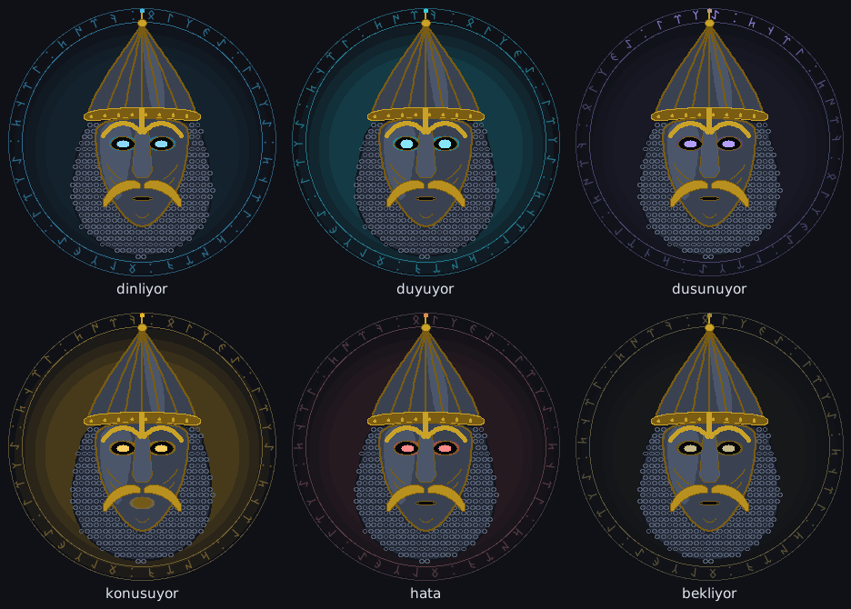

# İrle

**Türkçe konuşan, internetsiz de çalışan, Jarvis tarzı bir Windows asistanı.**

İrle'ye sesle konuşursun; o da seni anlar, bilgisayarında işi yapar ve senin üslubunla
cevap verir. İnternet varken ücretsiz bulut modellerini kullanır, yokken her şey
bilgisayarında çalışır.

<p align="center"></p>

---

## Neler yapabiliyor?

- **Türkçe anlar, kalıp ezberlemez.** "abi şu müziği biraz alçalt da kafam şişti",
  "sesi yüzde kırk beş yap", "kroma aç" (Chrome), "spotify'ı aç ve sesi kıs"
- **Bağlamı hatırlar.** "biraz daha", "geri al", "onu kapat", "ne dedin"
- **Hatırlatır.** "5 dakika sonra çayı hatırlat", "yarım saat sonra müziği durdur"
- **Sohbet eder.** Bilmediği cümleleri dil modeline sorar, araçları kendisi seçer
- **Senin gibi konuşur.** "kanka" dersen kanka gibi, "yapar mısınız" dersen "efendim" diye
  cevap verir. Acele ediyorsan soru sormaz, hemen yapar
- **Sözünü kesebilirsin.** Konuşurken "dur" ya da "İrle, sesi kıs" dersen susar
- **Yüzü var.** Kıpçak maskeli animasyonlu bir kafa: dinlerken, düşünürken ve
  konuşurken farklı hareket eder; ağzı çalan sesin şiddetine göre açılıp kapanır
- **Elinle fareyi kullan.** Kamera ile el takibi: tıkla, sürükle, sağ tık, kaydır; eli
  kameraya doğru iterek tıklama (derinlik). Hareket listesi: [docs/beyin.md](docs/beyin.md#el-ile-fare-kontrolü)
- **Telefonla kumanda.** Gamepad / klavye / fare (Flutter uygulaması)

Uygulama açma/kapatma, ses, parlaklık, müzik, notlar, ekran görüntüsü, pano, dosya
arama, pencere yönetimi, pil/sistem bilgisi, web araması, ekran kilidi ve
zamanlayıcılar hazır komutlar arasında.

## Nasıl çalışır?

```
 Mikrofon ─► KULAK ─────────► ANLAMA ─────────────► KOMUT ─────► Windows
            Groq Whisper      1. Anlama motoru       (tipli,       (uygulama, ses,
            → yerel Whisper      dil modelsiz,        güvenli)      medya, not...)
            → Google             anında                 │
                              2. Beyin                  ▼
                                 Groq → Ollama       SES ──► Hoparlör + yüz
                              3. Yedek kurallar      Piper (doğal Türkçe)
                                                     → Windows sesi
```

| Parça | İnternet varken | İnternet yokken |
|---|---|---|
| Kulak (konuşma → metin) | Groq Whisper large-v3-turbo (ücretsiz) | faster-whisper (bilgisayarda) |
| Beyin (anlama, sohbet) | Groq Llama 3.3 70B (ücretsiz) | Ollama + Qwen 2.5 (bilgisayarda) |
| Hızlı komutlar | Türkçe anlama motoru | aynı, zaten çevrimdışı |
| Ses (metin → konuşma) | Piper (bilgisayarda) | aynı |

Dil modeli **hiçbir şeyi doğrudan çalıştırmaz**; sadece tanımlı araçları çağırabilir.
Bunlar tipli komutlara (`SetVolume`, `CreateNote`...) dönüşür ve handler'lar çalıştırır.
Ayrıntılar: [docs/beyin.md](docs/beyin.md)

## Kurulum

Gereken: **Windows 10/11**, **Python 3.11+** (3.14 dahil), mikrofon. Ekran kartı şart değil.

```bat
git clone https://github.com/ataismailcinar-sketch/irle.git
cd irle
Kurulum.bat
```

`Kurulum.bat` her şeyi sırayla yapar: paketler, `.env` dosyası, Groq anahtarı (sorar),
Ollama ve yerel model (istersen kurar), Whisper modeli, Piper Türkçe sesi, MediaPipe
modelleri ve testler. Çıktıyı `kurulum_log.txt`'ye yazar. **İnternetsiz kullanacaksan bu
adımı internet varken bir kez çalıştır**; modeller indirildikten sonra internet gerekmez.

Sonra:

```bat
Irle_Baslat.bat
```

Her şeyin yerinde olup olmadığını görmek için: `python tools\hazirlik_kontrol.py`

### Ücretsiz Groq anahtarı (isteğe bağlı)

[console.groq.com](https://console.groq.com) → API Keys → Create API Key → `.env` içindeki
`GROQ_API_KEY=` satırına yapıştır. Kredi kartı istemez. Anahtar olmadan da İrle çalışır
(sadece yerel modellerle).

## Ayarlar

Tüm ayarlar `.env` dosyasında (örnek: [`env_ornek.txt`](env_ornek.txt)). En önemlileri:

| Ayar | Değerler | Ne işe yarar |
|---|---|---|
| `IRLE_BEYIN_MODU` | `hibrit` / `bulut` / `yerel` / `kapali` | Dil modeli nereden |
| `IRLE_KULAK` | `hibrit` / `yerel` / `groq` / `google` | Konuşma tanıma nereden |
| `IRLE_WHISPER_MODEL` | `small` / `medium` / `turbo` ... | Yerel tanıma modeli |
| `IRLE_SES_MOTORU` | `auto` / `piper` / `pyttsx3` | Konuşma sesi |
| `IRLE_PIPER_HIZ` | `1.0`, `1.15` ... | Konuşma hızı |
| `IRLE_UYANDIRMA` | boş / `irle` | Sadece "İrle ..." ile başlayan cümleleri dinle |
| `IRLE_KESME` | `true` / `false` | Konuşurken "dur" ile kesme |
| `IRLE_KULLANICI_ADI` | ör. `Ata` | Sana nasıl hitap etsin |

## Proje yapısı

```
main.py                     giriş noktası
Kurulum.bat / Irle_Baslat.bat
src/irle/
  domain/                   tipli komutlar, sorgular, olaylar (IO yok)
  app/                      ayarlar, komut kaydı, beyin servisi, fabrikalar
  adapters/
    intent/                 Türkçe anlama motoru, cevap şablonları, uyandırma, kesme
    brain/                  Groq/Ollama istemcisi, araçlar, kişilik
    speech/                 kulak (Whisper/Google) ve ses (Piper/Windows)
  handlers/                 Windows işlemleri (uygulama, medya, not, pencere...)
  infra/                    olay ve komut otobüsü, yankı kilidi, ses seviyesi
modules/                    ses, intent, TTS, GUI + Kıpçak yüzü, görüntü, telefon
kontrolcu_mobile/           Flutter telefon kumandası
tools/hazirlik_kontrol.py   kurulum/hazırlık kontrolü ve model indirme
tests/                      400+ test (donanım ve ağ gerektirmez)
docs/                       beyin.md (ayrıntılı kılavuz), mimari notları
```

## Testler

```bat
python -m pytest tests
```

Testler gerçek mikrofon, hoparlör, internet ya da model gerektirmez; hepsi sahte
nesnelerle çalışır. GitHub'da her push'ta otomatik çalışmaları için
[`docs/ci/testler.yml`](docs/ci/testler.yml) dosyasını `.github/workflows/` klasörüne taşı.

## Gizlilik

- `.env` (anahtarlar), konuşma geçmişi (`data/konusmalar.json`) ve notlar depoya girmez.
- Bulut modu açıkken konuştuğun cümleler Groq'a gider. İstemezsen
  `IRLE_BEYIN_MODU=yerel` ve `IRLE_KULAK=yerel`: her şey bilgisayarında kalır.

## Teşekkürler

[faster-whisper](https://github.com/SYSTRAN/faster-whisper) ·
[Piper](https://github.com/OHF-Voice/piper1-gpl) ·
[Ollama](https://ollama.com) ·
[Groq](https://groq.com) ·
[MediaPipe](https://ai.google.dev/edge/mediapipe) ·
Türkçe Piper sesleri: [rhasspy/piper-voices](https://huggingface.co/rhasspy/piper-voices)
(her sesin kendi lisansı vardır, ticari kullanımdan önce model kartına bak).

## Lisans

MIT — bkz. [LICENSE](LICENSE).
